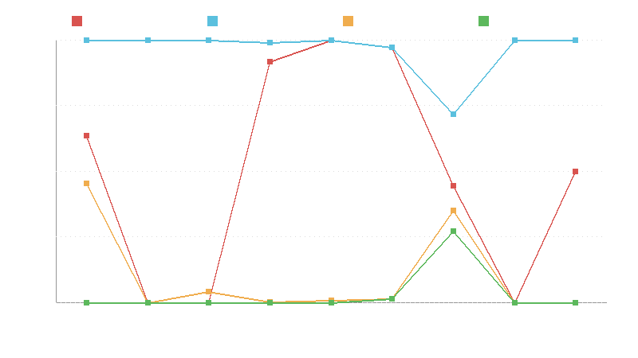

# Release Sentinel

[](https://github.com/Aryan2569/release-sentinel/actions)
[](https://opensource.org/licenses/MIT)

Release Sentinel is a time-aware static security gate that flags suspicious changes in npm dependency updates in pull requests before you merge them. Unlike vulnerability scanners that query advisory databases of known CVEs or dynamic sandboxes that execute untrusted code, Release Sentinel performs fast, safe, in-memory differential static analysis between published package versions at update time.

---

## Status: Public Alpha (v0.5.0)

Release Sentinel is in public alpha. It is engineered with an **advisory-first** philosophy:

- **Recommended initial adoption**: Configure `fail-on: never` (PR-comment-only advisory mode) or `fail-on: block` under the low-noise `default` profile. This allows security and platform teams to observe dependency alerts on their own pull requests and calibrate review thresholds before blocking merges.
- **Fail-closed guarantees**: If network errors, unsupported tarball sources, or safety limits are exceeded, Release Sentinel records explicit limitations and alerts rather than silently allowing uninspected code through.

---

## Quickstart

### Local CLI Installation

Install Release Sentinel from the alpha release tag using Python 3.12+:

```bash
pip install git+https://github.com/Aryan2569/release-sentinel@v0.5.0
```

### Auditing a Lockfile Diff

Audit changes between your existing and updated `package-lock.json`:

```bash
sentinel check --base package-lock.json.old --head package-lock.json.new
```

Or check changes directly against a git base branch in your repository:

```bash
sentinel check --base-ref origin/main --head package-lock.json
```

### Exit Code Semantics

- **`sentinel check` (CI Security Gate)**:
  - **`0` (Pass)**: All inspected package changes passed within configured security policy.
  - **`1` (Gate Failed)**: One or more package changes triggered a policy violation (`BLOCK`, or `WARN` when `--fail-on warn` is set).
  - **`2` (Usage / Input Error)**: Invalid arguments, malformed lockfiles, or unsupported formats (e.g. yarn/pnpm).
- **`sentinel diff` (Package Comparator)**:
  - **`0` (ALLOW)**: Clean package difference.
  - **`1` (WARN / Usage Error)**: Suspicious signals detected (`WARN` decision), or input/usage error (invalid `--format`, invalid `--as-of`, or invalid `--min-severity`).
  - **`2` (BLOCK / Registry Error)**: Severe security violations detected (`BLOCK` decision), or upstream registry retrieval failure (`RegistryError`).
  - **`3` (Internal Error)**: Unexpected unhandled exception.

---

## GitHub Action Usage

Add Release Sentinel to your repository by creating `.github/workflows/sentinel.yml`:

```yaml
name: "Dependency Security Gate"

on:
  pull_request:
    paths:
      - "package-lock.json"

jobs:
  audit-dependencies:
    runs-on: ubuntu-latest
    permissions:
      contents: read
      pull-requests: write # Required for posting PR comments
    steps:
      - name: Checkout repository
        uses: actions/checkout@b4ffde65f46336ab88eb53be808477a3936bae11 # v4.1.1
        with:
          # Fetch full history so base ref can be inspected via git show
          fetch-depth: 0

      - name: Run Release Sentinel
        uses: Aryan2569/release-sentinel@v0.5.0
        with:
          lockfile: "package-lock.json"
          fail-on: "block"
          comment-on: "notable"
          profile: "default"
          max-packages: 300
```

### Critical Security Rules for Using This Action

1. **Trigger on `pull_request`, NEVER `pull_request_target`**:
   `pull_request_target` executes in the context of the base repository branch and grants write tokens and secret access to fork PRs. An attacker opening a malicious pull request could exploit `pull_request_target` to exfiltrate repository secrets or compromise the repository. The `pull_request` trigger runs strictly within the unprivileged, read-only fork context.
2. **Require `fetch-depth: 0`**:
   The action diffs your updated lockfile against the base branch (`origin/${{ github.base_ref }}`). Passing `fetch-depth: 0` to `actions/checkout` ensures the base commit is available locally for `git show`.
3. **Zero Code Execution**:
   Release Sentinel never runs `npm install`, `node`, shell scripts, or lifecycle hooks. It inspects package diffs purely through static in-memory regex-based heuristics.
4. **Supply-Chain Hardening & Hash Locking**:
   The action dependencies are strictly pinned by cryptographic SHA-256 hashes (`requirements-action.lock`) and installed with `--require-hashes` and `--no-deps`. All third-party action dependencies are pinned by immutable 40-character commit SHAs.

### Action Configuration Options

| Input | Description | Default | Allowed Values |
| :---- | :---------- | :------ | :------------- |
| `lockfile` | Path to npm `package-lock.json` file | `package-lock.json` | Valid file path |
| `fail-on` | Threshold that causes the CI job to fail | `block` | `block`, `warn`, `never` |
| `comment` | Whether to post or update a GitHub PR comment with findings | `true` | `true`, `false` |
| `comment-on` | Condition to post or update PR comments. Teams wanting a quiet setup should set `comment-on: block`, because `notable` comments on ~30% of real-world dependency updates (mostly benign postinstall additions and network access). | `notable` | `block`, `notable`, `warn`, `always` |
| `experimental-hollow` | Enable experimental hollow-release detection (post-hoc WARN-only heuristic) | `true` | `true`, `false` |
| `policy` | Path to a custom TOML policy file to overlay | `""` | Valid file path or empty string |
| `profile` | Policy configuration profile | `default` | `default` (low-noise), `strict` (research baseline) |
| `max-packages`| Maximum changed packages to analyze before capping | `300` | Integer $\ge 1$ |
| `github-token`| Token for posting pull request comments | `${{ github.token }}` | GitHub token with PR write access |

> **Performance Note**: The composite action includes caching via `actions/cache@v4` for `~/.cache/release_sentinel` keyed on the lockfile hash. A cache hit drops the typical workflow run time from ~30s to ~2s.

---

## Example Pull Request Comments

When a suspicious or compromised package is detected in a dependency update, Release Sentinel posts an actionable review comment directly on the pull request.

### Advisory Warning (Advisory Gate: xios 1.14.0 → 1.14.1)

*Note: The dataset sample has its payload file removed, so the scanner reports the install hook's missing script target.*

<!-- release-sentinel-pr-comment -->
## Release Sentinel Security Gate

**Verdict:** ⚠️ **WARN** — 1 package(s) flagged with warnings out of 1 scanned.

### Flagged Packages

| Package | Version Change | Decision | Top Evidence | Why It Matters | Legitimate Explanation |
| :--- | :--- | :---: | :--- | :--- | :--- |
| `axios` | `1.14.0` → `1.14.1` | ⚠️ WARN | `install_script_present` | \[dep: plain-crypto-js@​4.2.1\] Lifecycle script 'postinstall' references script target 'setup.js' that is missing from the package. | Broken or incomplete package packaging. |

### Limitations & Scope

- JavaScript/TypeScript source scanned with static heuristics; dynamic evasion is possible.
- Every changed lockfile entry \(including transitive dependencies\) is scanned.

### Automated Block (2025 Install Hook Wave: @ahmedhfarag/ngx-perfect-scrollbar 20.0.19 → 20.0.20)

<!-- release-sentinel-pr-comment -->
## Release Sentinel Security Gate

**Verdict:** 🛑 **BLOCK** — 1 package(s) blocked out of 1 scanned.

### Flagged Packages

| Package | Version Change | Decision | Top Evidence | Why It Matters | Legitimate Explanation |
| :--- | :--- | :---: | :--- | :--- | :--- |
| `@​ahmedhfarag/ngx-perfect-scrollbar` | `20.0.19` → `20.0.20` | 🛑 BLOCK | `install_script_network` | Added lifecycle hook 'preinstall' downloads executable content from external network endpoints. | Precompiled platform binary downloads during installation. |

### Limitations & Scope

- JavaScript/TypeScript source scanned with static heuristics; dynamic evasion is possible.
- Every changed lockfile entry \(including transitive dependencies\) is scanned.

---

## How It Works

### 1. Differential Analysis, Not Whole-Package Scans
Traditional scanners inspect entire repositories or tarballs from scratch, creating immense false-positive noise on large, complex packages. Release Sentinel inspects only the delta between the previously published release and the proposed update. This focuses analysis strictly on newly introduced files, modified lines, and changed configuration.

### 2. Dependency-Aware Scanning
Supply chain attacks frequently inject malicious behavior by adding runtime dependencies rather than modifying package source directly. When an update adds a new direct runtime dependency, Release Sentinel resolves the package as of the update timestamp:
- If the dependency has prior published versions, it is diffed against its baseline.
- If it is a brand-new, single-version package, it is inspected in full-scan mode with corroborating heuristic requirements.

### 3. Dual Policy Profiles
- **`default` (Low-Noise CI Gate)**: Requires high-confidence corroborating evidence to block (such as install-time network downloads, credential file exfiltration, or CI workflow tampering). Heuristics like standalone base64 blobs or minified code emit warnings or summary notices without blocking builds.
- **`strict` (Research Baseline)**: The frozen v1.4 research policy evaluated across academic datasets. Alerts broadly on single indicators for high-assurance audits.

### 4. Lockfile Injection Defenses & Registry Hardening
- **Resolved URL Verification**: Verifies that any registry `resolved` URL matches the entry's declared name and version (`https://registry.npmjs.org/<name>/-/<basename>-<version>.tgz`). Mismatches emit `lockfile_resolved_mismatch` and BLOCK immediately under all profiles.
- **Integrity Requirement**: Entries omitting `integrity` hashes emit `lockfile_missing_integrity` (WARN).
- **Cryptographic Cache Binding**: Cache keys are bound to `(name, version, integrity or url hash)`. Corrupted downloads are purged immediately.
- **Streaming Tarball Limits**: Downloads are streamed in 64 KB chunks, enforcing a 100 MB per-tarball limit and a 500 MB session budget during download.
- **Metadata TTL**: Live registry lookups refresh cached metadata older than 1 hour.

### 5. Fail-Closed Live Architecture with Safety Budgets
To protect production CI against denial-of-service and evasive attacks, Release Sentinel enforces strict deterministic budgets:
- **Package Cap**: Scans up to 300 packages per update, prioritizing added packages and install hooks first.
- **Extraction Limits**: Soft caps degrade gracefully (extracting priority files when archives exceed 5,000 files or 200 MB uncompressed size, recording explicit limitations), while files exceeding 25 MB fail closed to WARN.
- **Linear-Time Chunking**: Files up to 25 MB are scanned in overlapping linear-time windows, preventing attackers from evading detection past initial file prefixes.

---

## Empirical Evaluation

Release Sentinel's detection efficacy and false alarm rates are evaluated on a frozen snapshot against the public [DataDog Malicious Software Packages Dataset](https://github.com/DataDog/malicious-software-packages-dataset) and real-world repository update histories.

### Malicious Recall Benchmark (1,349 Evaluation Pairs)

All metrics below are generated directly by [`scripts/verify_metrics.py`](scripts/verify_metrics.py) from canonical evaluation records in [`docs/METRICS.json`](docs/METRICS.json):

| Dataset Split | Pairs / Campaigns | Strict Profile Recall (v1.4) | Default Profile Recall (v0.5.0) | Lenient Campaign Recall (Default) [95% CI] |
| :--- | :---: | :---: | :---: | :---: |
| **DEV** | 857 pairs / 53 camp. | 98.95% WARN+ / 94.63% BLOCK | 98.95% WARN+ / 91.25% BLOCK | 48/53 (90.57%) [79.34%, 96.87%] |
| **VAL** | 94 pairs / 12 camp. | 100.0% WARN+ / 96.81% BLOCK | 100.0% WARN+ / 84.04% BLOCK | 12/12 (100.0%) [73.54%, 100.0%] |
| **TEST-A** (Tuned on / Post-hoc) | 274 pairs / 70 camp. | 95.99% WARN+ / 71.90% BLOCK | 95.99% WARN+ / 18.98% BLOCK | 63/70 (90.00%) [80.48%, 95.88%] |
| **TEST-B** (Aggregate) | 124 pairs / 5 camp. | 7.26% WARN+ / 2.42% BLOCK | 7.26% WARN+ / 1.61% BLOCK | 4/5 (80.00%) [28.36%, 99.49%] |
| **ALL** | 1,349 pairs / 140 camp. | 89.99% WARN+ / 81.69% BLOCK | 89.99% WARN+ / 67.83% BLOCK | 127/140 (90.71%) [84.64%, 94.96%] |

> **Note on Test Splits**: The `default` profile provides the **same WARN+ coverage as strict (89.99%)** (1,214 of 1,349 pairs; 127 of 140 campaigns) while demoting ambiguous single-signal heuristics to reduce CI noise. TEST-B is dominated by the hollow dependency-injection wave (metadata-only releases that add runtime dependencies without package code). The hollow-release and lookalike detection rules are experimental, post-hoc, and WARN-only.

### Attack Wave Breakdown: 2025 Install Hooks vs. 2026 Runtime Obfuscation

Supply chain attacks underwent a significant tactical shift between 2025 and 2026:

| Campaign Wave | Year | Total Packages | Attack Style | Strict Profile (v1.4) | Default Profile (v0.5.0) | Default Action Impact |
| :--- | :---: | :---: | :--- | :---: | :---: | :--- |
| **`camp_0052`** | 2025 | 407 pkgs | Install-hook download (`preinstall`) | 407 BLOCK / 407 WARN | **394 BLOCK** / 407 WARN | 🛑 Automated BLOCK (96.8%) |
| **`camp_0048`** | 2025 | 351 pkgs | Install-hook execution (`postinstall`) | 351 BLOCK / 351 WARN | **349 BLOCK** / 351 WARN | 🛑 Automated BLOCK (99.4%) |
| **`camp_0065`** | 2026 | 103 pkgs | Runtime obfuscation / dynamic loader | 103 BLOCK / 103 WARN | **0 BLOCK** / **103 WARN** | ⚠️ PR Review Advisory (100%) |
| **`camp_0066`** | 2026 | 60 pkgs | Encoded payload without install script | 0 BLOCK / 60 WARN | **0 BLOCK** / **60 WARN** | ⚠️ PR Review Advisory (100%) |
| **`camp_0136`** | 2026 | 118 pkgs | Hollow dependency-injection wave | 1 BLOCK / 3 WARN (4 WARN+) | **0 BLOCK** / **4 WARN** | ⚠️ PR Review Advisory (4/118) |

- **2025 Install Hooks**: The two largest 2025 waves (`camp_0052` and `camp_0048`) rely on automated execution during `npm install`. The default profile BLOCKs both waves almost completely (394/407 and 349/351).
- **2026 Waves**: Late-2025 and 2026 waves abandoned install scripts entirely. Waves like `camp_0065` (103 pkgs) and `camp_0066` (60 pkgs) rely on runtime obfuscation, while `camp_0136` (118 pkgs) is a hollow dependency-injection wave that injects lookalike dependencies. In the low-noise `default` profile, single uncorroborated heuristics cap at **WARN** to eliminate false-BLOCKs on production build tools. Consequently, Release Sentinel flags members of all three waves for human review via PR comments (warning on 103/103 members in `camp_0065`, 60/60 in `camp_0066`, and 4/118 in `camp_0136`).

### Real-World Replay Burden & PR Comment Optimization

To measure production signal-to-noise ratio, Release Sentinel was replayed across **288 historical dependency updates** spanning **5,965 scanned packages** in 12 major open-source projects (`bootstrap`, `commander`, `glob`, `helmet`, `marked`, `mocha`, `nodemon`, `rimraf`, `socket.io`, `superagent`, `terser`, `winston`):

- **Update-Level Verdicts**: Out of 288 updates, 162 are clean ALLOW (56.25%), 124 trigger warnings (43.06%), and 2 trigger BLOCK (0.69%).
- **Per-Package Warning Rate**: 901 warned packages out of 5,965 total packages (15.10%).
- **Integrity Verification**: `lockfile_missing_integrity` occurred on **0 of 288 replayed updates (0.00%)** across all 5,965 scanned packages (+0.0% addition to WARN rate), verifying that standard npm lockfiles consistently pin SHA-512 cryptographic hashes.
- **PR Comment Gating Threshold Evaluation**:
  We evaluated three PR comment thresholds across both the 288 real-world updates and all 140 benchmark campaigns:
  - **Variant A** (BLOCK, or WARN with HIGH/CRITICAL or install-hook change): Comments on 47 of 288 updates (16.3%), but only alerts on **84 of 140 campaigns (60.0%)**, completely missing 42 campaigns (including the 2026 waves).
  - **Variant B (`notable`, default)** (Variant A plus $\ge 2$ distinct MEDIUM signals): Comments on **86 updates (29.86%)**, while successfully alerting on **126 of 140 campaigns (90.00%)**—retaining 100% of the 2026 waves that comment under default profile.
  - **Variant C** (BLOCK only): Comments on 2 of 288 updates (0.69%), but drops campaign comment coverage down to **34 of 140 campaigns (24.29%)**.

Under `comment-on: notable` (Variant B), noisy PR comments are reduced from 126 updates (43.75%) down to **86 updates (29.86%)** — an immediate **31.7% reduction in PR noise** while preserving 90% campaign detection.

### Attack Style Evolution Over Time



*Figure 1: Evolution of npm supply chain attack vectors across discovery dates from late 2024 to October 2026 (based on METRICS.json and docs/attack_style_over_time.md). Attacks have progressively shifted away from standalone install scripts toward runtime dependency additions: malicious pairs adding a runtime dependency account for 1.2% in DEV, 1.1% in VAL, 17.1% in TEST-A, and 94.9% in TEST-B.*

---

## Security Model and Limitations

### What Release Sentinel Catches
- Install-time script execution (`preinstall`, `install`, `postinstall`) added or modified in dependency updates.
- Install-time file transfers and downloads (`curl`, `wget`, `fetch`, `http.get`).
- Environment variable enumeration and credential harvesting (`.npmrc`, `~/.ssh`, `~/.aws/credentials`).
- CI/CD workflow modifications attempting to capture GitHub repository tokens or workflow secrets.
- Newly introduced runtime dependencies carrying suspicious or uninspected payloads.

### What Release Sentinel Does Not Catch
- **Capability-Novelty Blind Spot**: Static capability signals (`eval()`, `child_process.exec()`, `http.get()`) are baseline-subtracted. If a package legitimately used those APIs in its baseline version, adding further calls to those same APIs in an update does not trigger new capability evidence unless accompanied by new unlisted hosts, encoded payloads, or install scripts.
- **Non-JavaScript Scripting Payloads**: Content analysis is specialized for JavaScript and TypeScript syntax. Scripts in `.sh`, `.ps1`, `.bat`, or `.py` trigger file-addition notices (`notable_new_file`) or lifecycle command warnings, but their internal script bodies are not parsed or scanned for language-specific constructs.
- **Hollow Dependency-Injection Waves (Metadata-Only)**: The newest wave of supply-chain attacks publishes hollow releases with empty bodies that inject lookalike runtime dependencies. In the low-noise default profile, these are warned on (4 of 118 members in `camp_0136`) under experimental, post-hoc rules.
- **TanStack-Style Bundled Tool Waves under Default Profile**: Multi-version dev tools and runtime loaders without install scripts cap at WARN under the low-noise default profile to prevent breaking legitimate developer builds.
- **Changed (Not New) Native Binaries**: Pre-existing `.node`, `.wasm`, `.so`, or `.dll` binary assets modified in an update are not decompiled, disassembled, or reverse-engineered.
- **Alternative Package Managers (Yarn / pnpm)**: Only npm `package-lock.json` (v1, v2, v3) is supported. `yarn.lock` and `pnpm-lock.yaml` are unsupported and rejected.
- **Private/Mirror Registries & Non-Registry Sources**: By default, only packages from the public npm registry (`https://registry.npmjs.org`) are inspected. Packages pointing to alternative registry mirrors (such as `registry.yarnpkg.com`), private registries, git repositories, or arbitrary remote URLs produce an unscanned non-registry source `WARN` (`unscanned_non_registry_source`) rather than being downloaded from untrusted endpoints.
- **No Live Remote GitHub Commit/Tag Validation**: Does not query GitHub or GitLab APIs to verify whether published npm tarballs correspond to signed commits or GitHub Actions OIDC provenance attestations (`npm provenance`).
- **Live Malware Dataset Warning**: The DataDog research dataset contains real, live malicious npm packages. Release Sentinel reads them solely in memory as inert data for static inspection; malicious code is never extracted to disk or executed.

For full technical specifications of evasion boundaries and mitigations, consult [`docs/LIMITATIONS.md`](docs/LIMITATIONS.md).

---

## Reproducing Our Benchmarks

Anyone can independently verify Release Sentinel's published metrics using the public DataDog research dataset without downloading any private malware corpora.

See [`docs/REPRODUCING.md`](docs/REPRODUCING.md) for step-by-step instructions on setting up sparse git checkouts and executing verification test harnesses.

---

## Roadmap

- **Lockfile Ecosystems**: Native parsing and diffing for `pnpm-lock.yaml` and Yarn (`yarn.lock` v1/v2).
- **Multi-Language Expansion**: Python supply chain analysis (`requirements.txt`, `poetry.lock`) via PyPI.
- **Custom Rule Plugins**: Extensible policy rule authoring via TOML.
- **IDE Extensions**: Pre-merge inline annotations in VS Code and JetBrains IDEs.

---

## License & Acknowledgments

Release Sentinel is licensed under the [MIT License](LICENSE).

We gratefully acknowledge the researchers and maintainers of the [DataDog Malicious Software Packages Dataset](https://github.com/DataDog/malicious-software-packages-dataset) and the public [npm Registry](https://registry.npmjs.org) for enabling open, reproducible security research.
